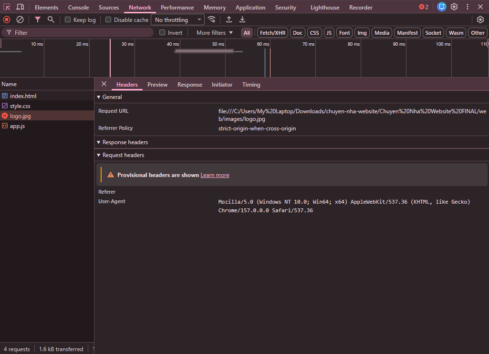
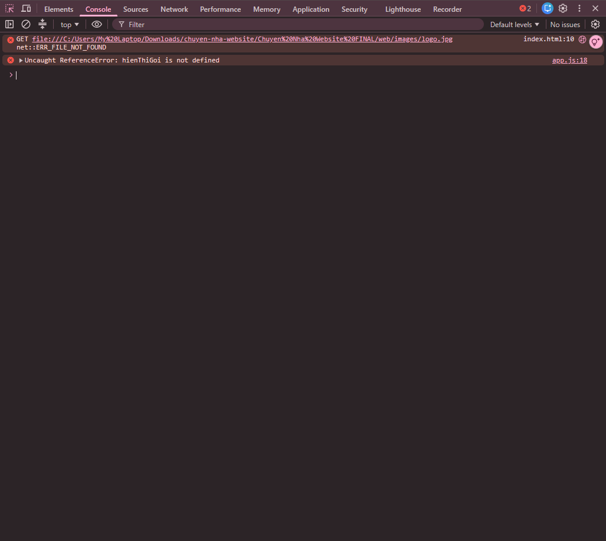

# BÀI LÀM – HACKATHON 02

- **Mã đề:** 10
- **Họ tên:** Nguyễn Hoàng Minh Phúc
- **Lớp:** CNTT2
- **Link repository:**
- **Hệ điều hành (Windows/macOS):** Windows

## 4.2. Thao tác máy tính cơ bản bằng CLI

### Các lệnh đã chạy

```
pwd
get-childitem
mv .\checklist_chuyen_nha.txt .\docs\
mkdir backup
cp .\data\hop_dong_thang_10.xlsx .\backup\
rm *.tmp
cd .\logs\; gc request.log; cd..
gci -recurse -force

```

### Kết quả liệt kê toàn bộ dự án (Windows: Get-ChildItem -Recurse -Force; macOS: ls -aR)

```
   Directory: C:\Users\My Laptop\Downloads\chuyen-nha-website


Mode                 LastWriteTime         Length Name
----                 -------------         ------ ----
d-----          11/11/26   1:35 PM                backup
d-----          11/11/26   1:33 PM                Chuyen Nha Website FINAL
d-----          11/11/26   1:33 PM                data
d-----          11/11/26   1:35 PM                docs
d-----          11/11/26   1:32 PM                evidence
d-----          11/11/26   1:33 PM                logs
-a----          03/11/26   7:08 AM             70 .env
-a----          03/11/26   7:08 AM           2410 bai_lam - Copy.md
-a----          03/11/26   7:08 AM           2410 bai_lam.md


    Directory: C:\Users\My Laptop\Downloads\chuyen-nha-website\backup


Mode                 LastWriteTime         Length Name
----                 -------------         ------ ----
-a----          03/11/26   7:08 AM           6139 hop_dong_thang_10.xlsx


    Directory: C:\Users\My Laptop\Downloads\chuyen-nha-website\Chuyen Nha Website FINAL


Mode                 LastWriteTime         Length Name
----                 -------------         ------ ----
d-----          03/11/26   7:08 AM                web


    Directory: C:\Users\My Laptop\Downloads\chuyen-nha-website\Chuyen Nha Website FINAL\web


Mode                 LastWriteTime         Length Name
----                 -------------         ------ ----
d-----          03/11/26   7:08 AM                images
-a----          03/11/26   7:08 AM            587 app.js
-a----          03/11/26   7:08 AM            544 index.html
-a----          03/11/26   7:08 AM            460 style.css


    Directory: C:\Users\My Laptop\Downloads\chuyen-nha-website\Chuyen Nha Website FINAL\web\images


Mode                 LastWriteTime         Length Name
----                 -------------         ------ ----
-a----          03/11/26   7:08 AM           3054 logo-movefast.png


    Directory: C:\Users\My Laptop\Downloads\chuyen-nha-website\data


Mode                 LastWriteTime         Length Name
----                 -------------         ------ ----
-a----          03/11/26   7:08 AM           6139 hop_dong_thang_10.xlsx


    Directory: C:\Users\My Laptop\Downloads\chuyen-nha-website\docs


Mode                 LastWriteTime         Length Name
----                 -------------         ------ ----
-a----          03/11/26   7:08 AM            155 checklist_chuyen_nha.txt


    Directory: C:\Users\My Laptop\Downloads\chuyen-nha-website\logs


Mode                 LastWriteTime         Length Name
----                 -------------         ------ ----
-a----          03/11/26   7:08 AM            973 request.log

```

## 4.3. Lọc log truy cập website

### a) Lệnh lọc các dòng status=500

```
gc .\logs\request.log | Select-string "status=500" > .\logs\loi_500.txt

```

### 2 dòng đầu tiên trong logs/loi_500.txt

```
2026-10-28 08:09:39 POST /api/dat-xe status=500
2026-10-28 08:13:50 POST /api/thanh-toan status=500

```

### b) Lệnh đếm số dòng status=404 và kết quả

```
gc .\logs\request.log | Select-string "status=404" | Measure-Object

```

```

Count    : 4
Average  :
Sum      :
Maximum  :
Minimum  :
Property :

```

## 4.4. Chạy script tong_hop (.ps1 hoặc .sh)

### Lệnh chạy (Windows: nếu dùng Phụ lục 2 thì ghi cả 2 lệnh)

```
Set-ExecutionPolicy Bypass -Scope Process
.\tong_hop.ps1
```

### Nội dung file logs/tong_hop.txt

```
=== BAO CAO SU CO WEBSITE ===

2026-10-28 08:28:45 GET /dat-xe-cu status=404
2026-10-28 08:41:29 GET /khuyen-mai-cu status=404
2026-10-28 08:50:02 GET /khuyen-mai-cu status=404
2026-10-28 09:05:46 GET /tin-tuc status=404


Count    : 6
Average  : 
Sum      : 
Maximum  : 
Minimum  : 
Property : 


```

## 4.5. README.md và bảo vệ thông tin bí mật

> README.md, .gitignore và .env.example được chấm trực tiếp trên file ở gốc dự án. Đánh dấu `[x]` vào các mục đã làm để tự kiểm tra.

- [x] README.md: Heading 1, mô tả có **in đậm** và *in nghiêng*, bảng, code block, task list, blockquote
- [x] .gitignore có dòng `.env` (tên file đúng, không có đuôi .txt)
- [x] .env.example có đủ tên biến, giá trị để trống (tên file đúng, không có đuôi .txt)

## 4.6. Kiểm tra trang web bằng DevTools (F12) và báo cáo lỗi

### Bảng lỗi

| STT | Tab DevTools phát hiện lỗi | Tên file hoặc thông báo lỗi | Cách khắc phục |
| --- | --- | --- | --- |
| 1 | Tab Network | net::ERR_FILE_NOT_FOUND  | Vào web/index.html trong vsc sửa đổi logo.png sang logo-movefast.png |
| 2 | Tab Console | Uncaught ReferenceError: hienThiGoi is not defined | Vào web/app.js trong vsc sửa hienThiGoi(); sang hienThiGoiChuyen();  |

> Ảnh chụp màn hình lưu trong thư mục `evidence/` (network.png, console.png).




### Báo cáo lỗi gửi trưởng nhóm

- **Context:** Tôi mở file web/index.html thì hiển thị ra lỗi ở Tab Console và cần nhờ nhóm trưởng hỗ trợ
- **Expected:** Tôi xem trên các nền tảng khác nhau, thấy mọi người thành công nên tôi đã thử xem
- **Actual:** Tôi đã thử đủ mọi cách nhưng vẫn không sửa được lỗi Console
- **Log:** Lỗi console: Uncaught ReferenceError: hienThiGoi is not defined

### Câu tìm kiếm Google

```
site:stackoverflow.com "Uncaught Referencerror: hienThiGoi is not defined"

```

## 4.7. Excel

> Phần Excel được chấm trực tiếp trên file `data/hop_dong_thang_10.xlsx`, không cần ghi vào đây.
